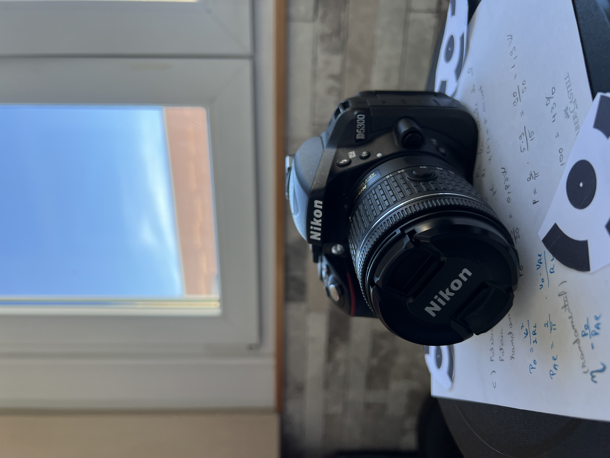
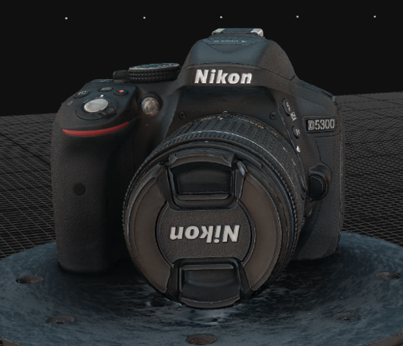
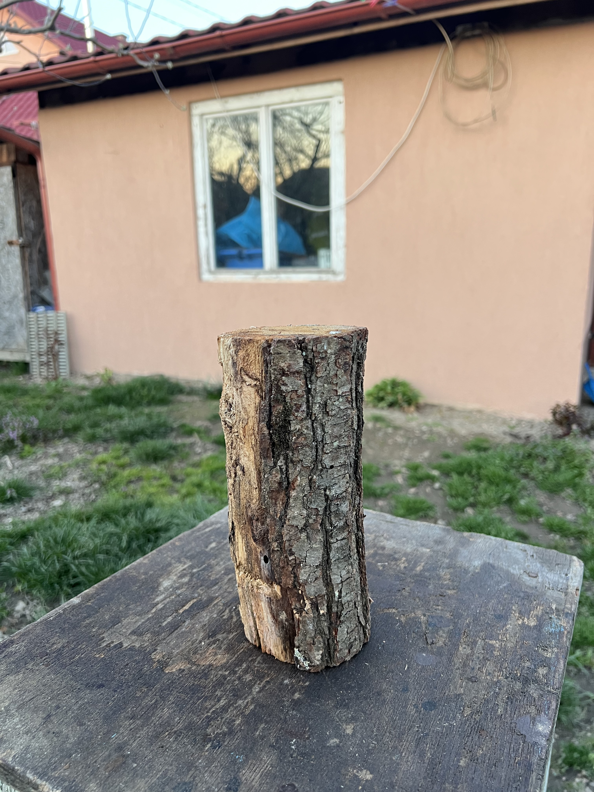
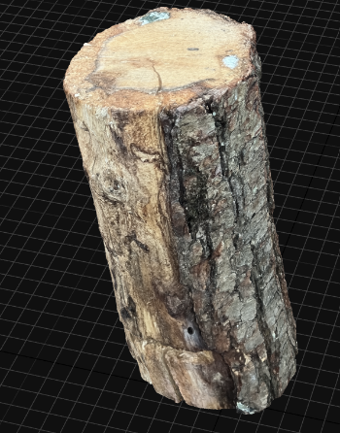

# Photogrammetry-Based 3D Reconstruction

## Project Overview

This project explores the reconstruction of three-dimensional models from photographs using photogrammetry and RealityScan.

The main objective was to analyze how different acquisition conditions and processing configurations influence the visual quality and completeness of the resulting 3D models.

## Objectives

- Analyze the influence of object texture and surface properties on reconstruction quality.
- Investigate the effects of lighting and image acquisition conditions.
- Compare reconstruction results obtained using different capture devices and configurations.
- Identify challenges associated with reflective surfaces and objects with limited texture.
- Explore the integration of reconstructed 3D models into multimedia applications.

## Tools and Technologies

- RealityScan – photogrammetric reconstruction
- Blender – 3D visualization and animation
- Digital cameras and smartphone photography

## Methodology

The project involved photographing several objects with different geometric and surface characteristics, processing the images in RealityScan, and evaluating the resulting models.

Multiple acquisition and processing scenarios were investigated to identify factors that influenced the visual quality and completeness of the reconstructions.

## Results

The experiments highlighted differences in reconstruction quality depending on the characteristics of the scanned objects and the conditions used during image acquisition.

Objects with rich surface texture generally provided more favorable conditions for photogrammetric reconstruction, while reflective surfaces and areas with limited texture presented additional challenges.

The resulting 3D models were also visualized in Blender.

## Project Materials

This repository contains selected project images, reconstruction examples, and documentation.

More detailed experimental results can be added as supplementary materials.

## Documentation

The complete bachelor's thesis can be accessed here:

